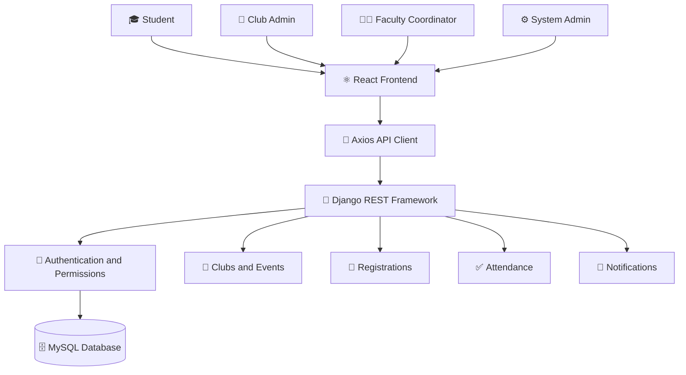

<div align="center">

# 🎓 CampusOS

### 🏫 Campus Club & Event Management System

**Discover · Organize · Participate · Grow**

A full-stack web application that brings campus clubs, events, registrations, attendance, and notifications together in one centralized platform.

<br/>


[📂 View Repository](https://github.com/vaishnavi519/CampusOS-College-Club-and-Event-Management-System)

</div>

---

## 📑 Table of Contents

- [🌟 Overview](#-overview)
- [🎯 Problem Statement](#-problem-statement)
- [✨ Features](#-features)
- [👥 User Roles](#-user-roles)
- [🛠️ Technology Stack](#️-technology-stack)
- [🏗️ System Architecture](#️-system-architecture)
- [📁 Project Structure](#-project-structure)
- [🚀 Getting Started](#-getting-started)
- [▶️ Running the Application](#️-running-the-application)
- [🧪 Testing](#-testing)
- [🔌 API Overview](#-api-overview)
- [🔐 Security](#-security)
- [🔮 Future Improvements](#-future-improvements)

---

## 🌟 Overview

**CampusOS** is a centralized campus club and event management system designed to simplify the way college activities are organized and managed.

Traditional campus management often relies on spreadsheets, paper forms, and messaging groups. CampusOS brings supported workflows into one web application, helping students and administrators access information more efficiently.

### 💡 What can you do with CampusOS?

- 🎪 Explore campus clubs and events.
- 📝 Register for events and track registrations.
- 👥 Access club management workflows.
- ✅ Review registrations and attendance.
- 🔔 Receive in-app notifications.
- 👤 Access personalized dashboards and profiles.
- 🔐 Use features according to assigned roles and permissions.

---

## 🎯 Problem Statement

Managing college clubs and events using disconnected tools can lead to:

- ❌ Inconsistent registration records
- ❌ Difficult attendance tracking
- ❌ Scattered event information
- ❌ Communication gaps between students and organizers
- ❌ Time-consuming administrative work

### 💡 Our Solution

CampusOS provides a centralized platform for:

- ✅ Club and event information
- ✅ Role-based access control
- ✅ Event registration workflows
- ✅ Attendance management
- ✅ In-app notifications
- ✅ Centralized backend APIs and database operations

---

## ✨ Features

<table>
<tr>
<td width="50%">

### 🎓 Student Portal

- 🔎 Browse clubs and events
- 📅 View event details
- 📝 Register for events
- 📋 Track personal registrations
- 🔔 View notifications
- 👤 Access profile information

</td>
<td width="50%">

### 🏢 Club Administration

- 🎪 Manage permitted club activities
- 📅 Access event information
- 👥 Review event registrations
- ✅ Record attendance
- 📊 Track registration status

</td>
</tr>
<tr>
<td width="50%">

### 🧑‍🏫 Faculty Coordination

- 📋 Access supported coordination workflows
- 🗂️ Review relevant information
- 🔐 Work within assigned permissions

</td>
<td width="50%">

### ⚙️ System Administration

- 🛠️ Access administrative workflows
- 👥 Support platform management
- 🔒 Use role-based permissions

</td>
</tr>
</table>

### 🔑 Authentication and Authorization

- 🔐 Login and registration
- 🎟️ JWT-based API authentication
- 🛡️ Role-aware frontend routes
- 🔒 Backend permission checks
- 🔑 Backend-managed password handling

---

## 👥 User Roles

| Icon | Role | Responsibilities |
|---|---|---|
| 🎓 | `STUDENT` | Discover clubs, register for events, and view personal information and notifications. |
| 🏢 | `CLUB_ADMIN` | Manage permitted club activities, registrations, and attendance. |
| 🧑‍🏫 | `FACULTY_COORDINATOR` | Access supported faculty coordination workflows. |
| ⚙️ | `SYSTEM_ADMIN` | Access platform administration workflows. |

> 🔐 Available actions depend on the user's assigned role and the permissions enforced by the backend.

---

## 🛠️ Technology Stack

| Technology | Purpose |
|---|---|
| ⚛️ React | Frontend user interface |
| ⚡ Vite | Frontend development and build tool |
| 📡 Axios | HTTP requests and API communication |
| 🐍 Python | Backend programming language |
| 🌿 Django | Backend web framework |
| 🔌 Django REST Framework | REST API development |
| 🗄️ MySQL | Relational database |
| 🔑 JWT | API authentication |
| 🧪 Django Tests and Python Scripts | Testing |
| 🐙 Git and GitHub | Version control |

---

## 🏗️ System Architecture

CampusOS follows a frontend–backend architecture in which the React frontend communicates with Django REST APIs, and the backend interacts with MySQL.



### 🔄 Application Workflow

1. 👤 Users sign in through the React frontend.
2. 📡 The frontend sends requests to Django REST APIs.
3. 🔐 The backend authenticates users and checks permissions.
4. 🗄️ Application data is retrieved from or stored in MySQL.
5. 📱 The frontend displays the information available to each role.

---

## 📁 Project Structure

```text
CampusOS-Clean/
│
├── 📂 backend/
│   ├── 📂 accounts/
│   ├── 📂 attendance/
│   ├── 📂 campusos/
│   ├── 📂 clubs/
│   ├── 📂 events/
│   ├── 📂 notifications/
│   ├── 📂 recommendations/
│   ├── 📂 registrations/
│   ├── 📂 reports/
│   └── 📄 manage.py
│
├── 📂 frontend/
│   ├── 📂 src/
│   │   ├── 📂 components/
│   │   ├── 📂 pages/
│   │   └── 📂 services/
│   ├── 📄 package.json
│   └── 📄 .env
│
├── 📂 test_cases/
│   ├── 📄 test_campusos.py
│   ├── 📄 test_case_10.py
│   ├── 📄 test_login.py
│   ├── 📄 test_event_registration.py
│   └── 📄 ...
│
├── 📄 manage.py
├── 📄 models_existing.py
└── 📄 README.md
```

---

## 🚀 Getting Started

### 📋 Prerequisites

Before running CampusOS, make sure you have installed:

- 🐍 Python
- 📦 Node.js and npm
- 🗄️ MySQL Server
- 🐙 Git

### 1️⃣ Clone the Repository

Open PowerShell:

```powershell
git clone https://github.com/vaishnavi519/CampusOS-College-Club-and-Event-Management-System.git

cd CampusOS-College-Club-and-Event-Management-System
```

### 2️⃣ Create a Python Virtual Environment

```powershell
python -m venv .venv
.\.venv\Scripts\Activate.ps1
```

### 3️⃣ Install Backend Dependencies

If the project contains `backend/requirements.txt`, run:

```powershell
pip install -r .\backend\requirements.txt
```

Otherwise, use the dependency file provided in the repository.

### 4️⃣ Configure MySQL

- 🗄️ Start the MySQL server.
- 🛠️ Create the database configured in Django settings.
- 🔑 Configure the database credentials.
- 🔒 Keep passwords and secret keys out of GitHub.

### 5️⃣ Apply Database Migrations

From the project root:

```powershell
$env:PYTHONPATH = "$PWD\backend"
python manage.py migrate
```

---

## ▶️ Running the Application

Run the backend and frontend in **two separate PowerShell terminals**.

### 🖥️ Terminal 1 — Backend

```powershell
cd C:\Users\Lenovo\Desktop\CampusOS

.\.venv\Scripts\Activate.ps1

$env:PYTHONPATH = "$PWD\backend"

python manage.py runserver
```

🌐 **Backend:** http://127.0.0.1:8000/

### 💻 Terminal 2 — Frontend

```powershell
cd C:\Users\Lenovo\Desktop\CampusOS\frontend

npm install

npm run dev
```

🌐 **Frontend:** http://localhost:5173/

### 🔗 API Configuration

The frontend API URL is configured in `frontend/.env`:

```env
VITE_API_URL=http://127.0.0.1:8000/api
```

> 💡 Restart the Vite development server after changing environment variables.

---

## 🧪 Testing

CampusOS includes Django tests and standalone Python test scripts.

### 🧪 Run Django Tests

From the project root:

```powershell
$env:PYTHONPATH = "$PWD\backend"
python manage.py test
```

### 🎯 Run Individual Test Scripts

```powershell
python .\test_cases\test_login.py

python .\test_cases\test_event_registration.py

python .\test_cases\test_case_10.py
```

## 🔌 API Overview

The backend exposes REST endpoints under `/api/`.

| Icon | Area | Example Endpoint | Purpose |
|---|---|---|---|
| 🔑 | Authentication | `POST /api/auth/login` | Authenticate a user |
| 📝 | Registration | `POST /api/auth/register` | Register a user |
| 🏢 | Clubs | `GET /api/clubs` | List clubs |
| 📅 | Events | `GET /api/events` | List events |
| 📋 | My Registrations | `GET /api/my-registrations` | View personal registrations |
| 📝 | Event Registration | `POST /api/events/{event_id}/register` | Register for an event |
| 👥 | Event Registrations | `GET /api/events/{event_id}/registrations` | View event registrations |
| ✅ | Attendance | `GET /api/events/{event_id}/attendance` | View attendance |
| 🔔 | Notifications | `GET /api/notifications` | View notifications |

🔐 Authenticated requests must include a valid access token.

---

## 🔐 Security

- 🔒 Never commit passwords, access tokens, or secret keys.
- 👤 Use test accounts for demonstrations.
- 🛡️ Enforce access control on the backend.
- 🚫 Do not expose the development server directly to the public internet.
- 🧹 Review logs and error messages before sharing screenshots.
- 🔑 Keep sensitive configuration in environment-specific files.

---

## 🔮 Future Improvements

- 🧪 Expand automated integration and end-to-end testing.
- 📊 Add more reporting and export options.
- ♿ Improve accessibility.
- 📱 Enhance responsive layouts.
- ⚙️ Add continuous integration checks.
- 🚀 Document deployment and production configuration.

---

## 📂 Project Repository

<div align="center">

### 🎓 CampusOS

**Campus Club & Event Management System**

A centralized platform for campus clubs, events, registrations, and attendance.

[](https://github.com/vaishnavi519/CampusOS-College-Club-and-Event-Management-System)

**Built with ❤️ using React, Django REST Framework, and MySQL.**

</div>
